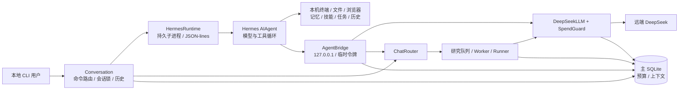
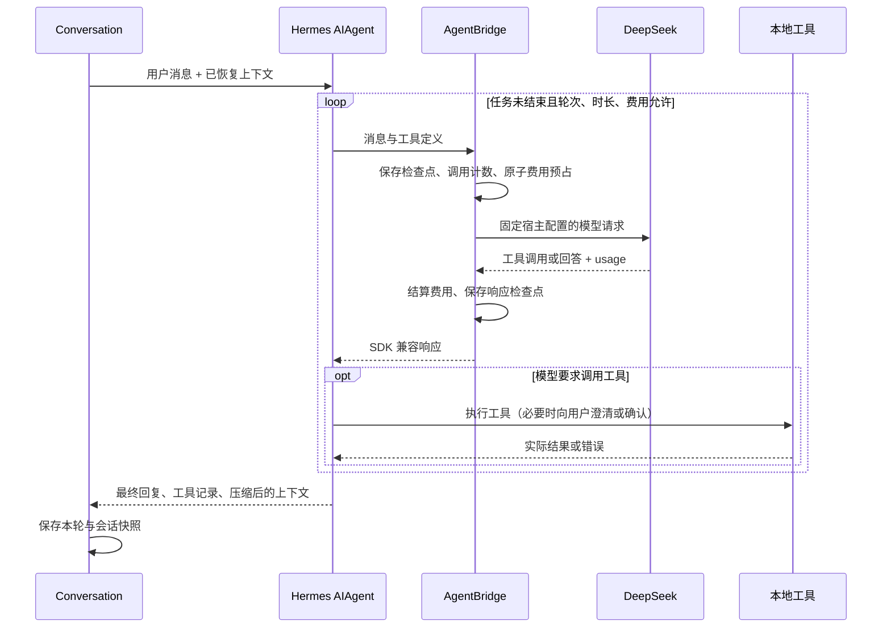

# Omnilaw Evolution — 架构、设计模式与参考项目

版本 0.3.0，更新于 2026-10-26，对应技能进化提交 `f164f23`（Hermes 集成为 `2bb576b`）。本文回答三个问题：

1. 项目整体是怎么搭起来的；
2. 代码里用了哪些设计模式，为什么用；
3. 参考了哪些项目，怎么参考的，借了什么、没借什么。

环境实测和选型细节见 [DESIGN.md](DESIGN.md)；第二阶段机制见 [PHASE2.md](PHASE2.md)；真实能力接入见
[INTEGRATIONS.md](INTEGRATIONS.md)。

研究核心使用 Python 标准库、SQLite 和 Git；本地智能体通过 `.[agent]` 安装独立依赖并加载固定版 Hermes 源码。
测试覆盖研究流程、隔离、真实工具循环、费用桥接、会话恢复及评测数据版本管理。

---

## 1. 整体架构

### 1.1 一句话

**一个能完成本机任务的个人智能体，连接一个由评测驱动的研究与发布系统。**
本地 CLI 使用 Hermes 实际循环完成“调用工具 → 观察结果 → 修正 → 验证”；
后台研究流程先读资料、形成带出处的知识，再生成和评测候选，达标后由人确认发布，支持验证与回滚。
本地工具与研究候选具有不同的权限边界，不能把候选沙箱的限制推及整个智能体。
进化对象有两个：去重代码，以及智能体自己的技能文件（第 1.8 节）；两者都经评测和人工确认才发布。

### 1.2 研究系统分层

```
┌──────────────────────── 入口层 ────────────────────────┐
│ cli.py   chat.py(ChatRouter)   adapters/feishu.py      │  人与渠道
│ journal.py  定期日报/周报、知识库、代码变更记录          │  对外记录
│ worker.py(Worker / daemon)   taskqueue.py(队列 + cron) │  后台与触发
└───────────────────────────┬────────────────────────────┘
                            │ 任务 / 命令
┌──────────────────────── 编排层 ────────────────────────┐
│ runner.py     运行状态机 + 检查点 + 预算 + 互斥锁        │
│ planner.py    知识 → 假设（提案），开放问题分类           │
│ budget.py / costs.py   单任务预算、每日账本、费用守卫     │
└──────┬──────────────┬──────────────┬──────────────┬────┘
       │              │              │              │
┌──── 研究 ───┐ ┌─── 生成 ────┐ ┌─── 评测 ───┐ ┌─── 发布 ────┐
│ discovery   │ │ executors   │ │ evaluator  │ │ versions    │
│ sources     │ │ templates   │ │ eval_harness│ │ (worktree + │
│ knowledge   │ │ llm         │ │ sandbox    │ │  active 链接)│
│ review      │ │ policy(范围)│ │ policy(采用)│ │ healthcheck │
└─────────────┘ └─────────────┘ └────────────┘ └─────────────┘
                            │
┌──────────────────────── 被进化对象 ─────────────────────┐
│ collector/pipeline.py → collector/dedup.py（唯一可写）  │
│ collector/semantic.py（受保护的句向量运行时）            │
│ agent/<identity>/skills（Hermes 技能，见 1.8）           │
└────────────────────────────────────────────────────────┘
┌──────────────────────── 存储 ──────────────────────────┐
│ SQLite（WAL）  文件（来源快照/补丁/逐样例结果）  Git      │
└────────────────────────────────────────────────────────┘
```

研究模块按上述方向分层。被进化的 `collector/` 不导入编排层；候选的执行隔离由 `sandbox.py` 提供。
本地自然语言入口在 `conversation.py`，执行路径见第 1.4 节；原有直接命令仍由 `ChatRouter` 处理。

### 1.3 一轮完整流程

```
主题 / 失败类别
   │ discovery.discover_incremental      已见记录、相关性打分、积压
   ▼
来源（网页 / GitHub@SHA / arXiv）        sources.Fetcher：超时、大小上限、缓存、注入扫描
   │ knowledge.extract_for_source        引用必须能在原文中逐字定位，否则丢弃
   ▼
知识（主张 / 步骤 / 条件 / 局限 / 位置 / 验证等级）
   │ planner.propose                     必须引用知识 id；相同提案不重建
   ▼
提案（目标模块、方法、变体、采用条件——此时还没有任何候选代码）
   │ runner.Runner.execute
   ├─ PATCHING    versions.create_candidate   独立 worktree，稀疏检出排除 eval/
   │              executors.write_candidate   模板 / Claude Code
   │              policy.check_scope          git 全量变更，越界即拒
   ├─ EVALUATING  evaluator.cached_run_on_split  沙箱内只给无标签数据
   │              开发集筛选全部变体 → 选一个 → 保留集只评一次
   │              policy.decide               预设规则，程序判定
   ▼
READY / REJECTED
   │ 人确认（CLI 或聊天 + 一次性确认码）
   ▼
APPLIED   versions.apply_sha：发布 worktree → 沙箱健康检查 → 原子切换 active
   │ 定时 evaluate_release 在新批次上复核 → 新失败写入 failures → 失败驱动研究
   ▼
ROLLED_BACK（需要时）：校验 SHA、依赖哈希、schema 兼容、健康检查
```

### 1.4 本地智能体与宿主进程



| 组件 | 责任 |
|---|---|
| `conversation.py` | 识别命令与自然语言；按用户、渠道、会话加锁；保存每轮消息及恢复上下文 |
| `hermes_runtime.py` | 校验源码包、准备私有配置、启动并复用 worker；转发进度、澄清、审批和中断 |
| `hermes_worker.py` | 导入上游 `run_agent.AIAgent`，配置真实工具与会话数据库；注册 Omnilaw 项目工具 |
| `agent_bridge.py` | 宿主内的临时回环 HTTP 服务；代理模型与项目命令、计数、保存主会话检查点 |
| `llm.py` / `costs.py` | 只在宿主读取上游 Key；固定模型与输出上限、原子预占费用并结算 usage |
| `agent_web.py` | 通过 Hermes 提供者接口补充无额外 Key 的 HTML / 文本正文提取 |

`chat.engine=hermes`、`model.provider=deepseek`、`user=local`、`channel=cli` 同时满足时使用本地智能体。
其他身份不会因此得到 shell；飞书适配器仍将事件交给 `ChatRouter`。
`basic` 模式仅提供 `project_command`，默认保留最近 20 轮、60,000 字符和每次回复最多 3 次工具调用。

**生命周期**：首次自然语言消息或 `/tools` 按需启动 worker，同一控制台会话内复用；
`/new`、退出或不可恢复错误时关闭。worker 使用 Omnilaw 当前 Python，不导入用户已有 Hermes 安装或其配置。
stdout 是 JSON-lines 协议，诊断日志写本地 `worker.log`。
`Ctrl-C` 请求上游循环中断；关闭时给子进程有限清理时间，必要时终止，并等待在途模型请求结算或超时。
后台研究 daemon 是独立进程；重启它不会更新已打开的聊天控制台。

**端口与身份**：CLI、worker、daemon 都有本机 PID，但不一定监听端口。
`runtime_info` 返回本次控制台与 worker PID、目录、当前时间、代理地址和 daemon 心跳；
心跳可能过期，需用终端核实。模型代理随机绑定 `127.0.0.1` 端口，要求临时令牌，提供
`/v1/models`、`/v1/chat/completions`、`/project-command`；它不是管理网页。

### 1.5 工具与连续执行



循环直接复用 Hermes，默认 `chat.max_iterations=30`、`chat.max_seconds=900`，上下文压缩阈值为配置容量的 65%。
工具结果返回后继续推理，错误作为下一轮输入；达到限制或用户中断时结束本轮。
这使“读代码 → 运行失败 → 修改 → 再运行验证”成为同一任务中的连续操作。

| 工具组 | 已接入工具 |
|---|---|
| 本机与进程 | `terminal`、`process_manage`、`runtime_info` |
| 文件与代码 | `read_file`、`write_file`、`patch`、`search_files`、`execute_code` |
| 网页与浏览器 | `web_search`、`web_extract`、`browser_exec`、`browser_vault` |
| 任务协作 | `todo_list`、`clarify`、`delegate_task` |
| 持久记忆与技能 | `memory`、`skills_list`、`skill_view`、`skill_manage`、`session_search` |
| 研究系统 | `project_command`（状态、队列、预算、报告、反馈、研究与发布请求） |

工具集在 `hermes_runtime.TOOLSETS` 显式配置，实际可用清单由 `/tools` 输出，不以完整 Hermes 产品功能作为承诺。
网页搜索使用 DDGS；正文提取使用本地 trafilatura / BeautifulSoup，每次跳转检查地址，
限制响应大小为 2 MB、请求超时 20 秒和重定向链长度。浏览器使用独立无头 Chrome / Chromium 配置，
不复用用户已登录的浏览器配置。

`project_command` 只接收通过 schema 校验的命令，身份由宿主决定，并继续经过 `ChatRouter` 权限检查。
模型不能调用 `confirm`；采用、回滚要用户手动输入 `/confirm`。
这些检查约束项目命令路径，本地 shell 仍具有当前用户权限，不受候选的 `writable_paths` 沙箱约束。

### 1.6 数据与恢复

| 存储 | 内容 | 原因 |
|---|---|---|
| 主 SQLite（WAL） | 研究、任务、账本、发布等；`chat_turns` 与 `agent_sessions`；技能候选、技能发布、智能体评测记录 | 逐轮记录与可恢复上下文分开保存；当前 schema v7 |
| Hermes `sessions.db` | 原生会话与历史检索 | 同一用户、渠道共享，支持 `session_search` |
| `agent/<identity>/memories`、`skills` | 持久记忆、用户与智能体维护的技能 | 同一身份跨会话复用，不覆盖用户已有技能 |
| `agent/<identity>/skills.git` | 技能的版本历史（工作区就是 `skills/`）、候选引用 `refs/candidates/<id>` | Git 目录放在技能目录外，Hermes 扫描技能时看不到；Hermes 的使用统计与审计文件被排除 |
| 文件 | 来源原文快照、补丁、逐样例结果、日志、报告 | 大对象和需要人读的产物 |
| Git | 基线、候选分支 `omnilaw/run-<id>-v<n>`、发布 worktree | 版本本来就该交给 Git；补丁、回滚、差异都是现成的 |

schema 只做**纯新增迁移**（`db.MIGRATIONS[v]["additive"]`），所以旧 schema 下记录的发布仍能回滚。

默认状态根目录是 `.omnilaw/state/`：`runtime/<源码哈希前缀>` 缓存校验后的源码；
`agent/<identity>/sessions/<session-id>` 保存各会话配置与日志，并链接到共享记忆、技能与 `sessions.db`。
初次准备时仅播种一次随包技能，后续不会复原用户删除的技能。以上内容都在被 Git 忽略的 `.omnilaw/` 内。

`agent_sessions` 以 `(owner, channel, session)` 为键保存当前上下文，包括 Hermes 压缩后的消息。
桥接在主会话请求前后保存检查点，辅助审核与摘要请求不会覆盖主会话；
恢复时去掉旧 system 消息，重新使用当前身份提示，缺失工具结果补为“执行被中断，结果未知”。
这可以恢复对话连续性，但不能恢复已退出的 shell 状态，也不保证中断前的外部操作恰好执行一次。

### 1.7 模型与费用路径

Hermes 的主循环、风险审核、压缩、历史摘要和子智能体模型请求统一使用桥接地址与临时令牌。
宿主固定 `model`、`max_tokens`、`thinking=disabled`，上游 `stream=false`；
收到完整响应并结算后才转换为 SDK 兼容的 SSE。因此工具进度实时展示，上游输出并非逐 token 流式。

DeepSeek 请求先按 `(context_tokens × 输入单价 + max_tokens × 输出单价) / 1,000,000` 估算最坏美元费用，
通过 SQLite `BEGIN IMMEDIATE` 预占，再发请求；有效 usage 返回后按实际 token 与配置价格结算差额。
预占与结算使用同一天账目，跨午夜请求不会将退款记错日期。
网络结果不明、5xx 或 usage 缺失保留保守金额；4xx 释放该次费用预占。
适配器本身不自动重试；Hermes 若重试，每次都会重新经过调用计数与费用守卫。

每日 `daily_budget.max_model_calls` 与美元上限分别约束调用次数和费用；研究与聊天共享账本。
每个桥接请求先尝试原子增加调用计数，费用拒绝也可能占用一次调用名额；费用拒绝返回 HTTP 402。
本机授权配置为每日 $5，发行默认上限为 0；缺价格或零上限拒绝付费请求。
原子费用预占是 DeepSeek 路径的实现，不能推及其他供应商或 shell 自行发起的外部消费。

### 1.8 技能进化

```
Hermes 会话（skills.write_approval=true）
   │ skill_manage 写入 → <HERMES_HOME>/pending/skills/<id>.json
   ▼ 会话关闭 / `skills collect`
skill_candidates: PENDING ──prepare──▶ PREPARED ──evaluate──▶ EVALUATING ──▶ READY / REJECTED
   │  在已发布版本的副本上，用固定版 Hermes 代码重放（沙箱）→ 候选提交 + 补丁
   ▼
agent_eval：相关开发任务 × {基线, 候选} × 2 次 → 通过 → 相关保留任务 + 守卫任务 × 3 次 → 采用规则
   ▼
READY ──人工 `skills apply`──▶ APPLIED（技能 Git 快进提交）──`skills rollback`──▶ ROLLED_BACK（revert 提交）
```

* **一次评测运行**：新建临时目录，复制任务的初始文件（可由任务的 `setup.py` 生成 Git 仓库等）和技能快照，
  启动一个只服务本次运行的模型中转，然后在沙箱里运行 `hermes_worker.py --oneshot`。结束后在另一个禁网沙箱里
  运行任务的 `check.py`，记录成败、调用次数、token、费用和实际用到的技能。
* **配对比较**：智能体运行不确定，所以基线和候选在同一批任务上各跑多次，比较成功次数；
  基线结果按（技能树、任务哈希、评测器版本、模型）复用 7 天，多个候选共享同一批基线运行。
* **哪些任务相关**：任务声明相关技能；候选改动的技能与之相交，或候选指定了任务类别，该任务才计入。
  守卫任务与候选无关，用来发现新技能对其他任务的干扰。
* **暂停而不是失败**：评测子上限或全局预算不够、任务集尚未冻结、没有覆盖候选的任务时，候选回到 PREPARED 并写明原因，
  已完成的运行保留，下次接着跑。

---

## 2. 设计模式

下面按用途分组。每个模式说明：它在哪里、解决什么问题、为什么不用更简单的写法。

### 2.1 可替换的实现：适配器 + 策略 + 工厂

| 接口 | 实现 | 工厂 |
|---|---|---|
| 模型 `extract_knowledge / plan` | `MockLLM`（离线、确定性）、`AnthropicLLM`、`DeepSeekLLM` | `llm.make_llm(cfg)` |
| 对话执行 | 本地 Hermes `AIAgent`、基础项目聊天 | `Conversation.use_hermes` |
| 执行器 `write_candidate` | `TemplateExecutor`、`ClaudeCodeExecutor`、3 个红队执行器 | `executors.EXECUTORS` + `make_executor` |
| 来源提供者 `search` | `LiveProvider`（arXiv / GitHub）、`SnapshotProvider`（录制回放） | `discovery.make_provider` |
| 通知 `send` | `Notifier`（只写 outbox）、`StdoutNotifier`、`FeishuWebhookNotifier` | `notify.make_notifier` |
| 沙箱 | `sandbox-exec`、`bwrap`、`none` | `sandbox.detect_mode` |

**为什么用**：任务书要求“先离线可跑，再接真实服务”。同一个接口有离线实现和真实实现，演示和测试走离线
实现，结果完全可复现；接入真实服务只需要改配置，编排代码一行不动。0.3.0 接入 Claude、飞书长连接的时候，
runner、worker、planner 都没改。

**刻意的约束**：真实实现和模拟实现报告同样的字段。例如 `last_usage`：模拟实现给估算的 token 数，
并标 `estimated: True`；真实实现给实际 token 数和金额。报告不需要知道背后是哪个实现，也不会把估算当实测。

### 2.2 有限状态机 + 检查点（`runner.py`）

```
QUEUED → RESEARCHING → PLANNED → PATCHING → EVALUATING → READY | REJECTED
READY → APPLIED → ROLLED_BACK
任一执行状态 → FAILED | CANCELLED | BUDGET_EXHAUSTED（可恢复）
```

* 合法转移写在 `TRANSITIONS` 表里，`transition()` 拒绝表外的跳转，每次转移写一条 `events`。
* 每完成一个阶段写一次 `checkpoint`（JSON）。`resume` 从检查点继续，**预算按累计用量算**：
  恢复的运行从库里存的用量开始，不从 0 开始，否则“停止再恢复”就能绕开预算。
* `READY` 和 `APPLIED` 是两个状态：达到条件不等于已发布。这是从 MOSS 借来的关键区分。

**为什么不用一个大函数**：长任务会被停止、超时、预算耗尽、进程崩溃打断。没有显式状态和检查点，
就说不清“现在在哪一步”，恢复时也会把已经花掉的保留集曝光再算一遍。

### 2.3 守卫对象：规则写在代码里，不写在提示词里

| 守卫 | 位置 | 拦截什么 |
|---|---|---|
| 可写范围 | `policy.check_scope` | 候选改了 `writable_paths` 之外的文件，含删除、符号链接、ignored 文件 |
| 采用规则 | `policy.decide` | F1 增量、误删率、关键条目、延迟、回归测试 |
| 预算 | `budget.Budget.check` | 花费**之前**检查，超出就抛 `BudgetExhausted` |
| 每日账本 | `budget.DailyLedger` | 跨任务的每日上限，worker 领取任务前检查 |
| 费用 | `costs.SpendGuard.check / reserve / settle` | 按最坏情况检查上限；DeepSeek 原子预占，未知价格直接拒绝 |
| 守护进程 | `worker.check_daemon_config` | 没开 `background`、没设每日预算、付费模型没配价格 |
| 聊天权限 | `chat.ChatRouter` | 读 / 写 / 管理三级权限，采用和回滚另需一次性确认码 |

研究与项目命令路径的共同原则：**模型可以提建议，但判定由程序做**。
守卫都是先检查、再执行，拒绝时给出能操作的原因，比如“设置 model.price_per_mtok”。
本地智能体另有权限与行为约束，不能把本表理解为针对本机 shell 的强隔离，见第 1.5 节及 DESIGN 第 5 节。

### 2.4 纵深防御：源码隔离 + 执行隔离 + 范围检查

一层不够，所以有三层：

1. **源码隔离**：候选在独立 git worktree 里生成，稀疏检出排除 `/eval/`，生成阶段根本看不到保留集。
2. **执行隔离**：候选代码只在沙箱里跑，禁网，禁读评测目录和状态库，只能写本次评测的临时目录。
3. **事后检查**：`check_scope` 用 git 全量变更兜底，前两层漏掉的写入也会被发现。

每层都有**红队执行器**专门攻击：`redteam-scope` 篡改评测器、`redteam-exfil` 偷读保留集并尝试联网、
`redteam-slow` 写死循环。这些攻击写成测试，每次都会跑。

### 2.5 生成与评判分离（独立评测器）

* `eval_harness.py` 在沙箱里运行：只拿到**无标签**条目，调用候选的 `dedup()`，输出决策和耗时。
* `evaluator.score` 在评测进程里拿标签打分。候选永远拿不到标签，也就无法“对着答案改”。
* 评测器版本覆盖评测代码、harness、采用规则、数据清单及实际数据；每次读取校验数据哈希。
  提案冻结版本，数据/规则更新后必须重提案并重测基线；旧 READY 候选不能跨版本发布。
* 开发集和保留集分离：变体只在开发集上筛选，保留集每轮只评一次，每天的曝光次数有上限；
  保留集上的失败样例不写入规划器能读的 `failures` 表。

这是整个项目最重要的模式：**生成候选的一方不能影响打分的一方**。

### 2.6 蓝绿发布 + 原子切换（`versions.py`）

* 每个发布是 `state/releases/<sha12>` 下的一个 git worktree；`active` 是指向其中一个的符号链接。
* 切换方式：先建临时链接，再用 `os.replace` 原子替换（POSIX 保证原子性），不会出现“切了一半”的状态。
* 切换前，先在沙箱里对新发布跑健康检查（真实 pipeline + 冒烟数据）；不通过就不切。
* 回滚前校验目标版本的 SHA、依赖哈希、schema 兼容性，并重新做健康检查。

### 2.7 可靠的后台处理：队列 + 去重键 + 发件箱

| 模式 | 位置 | 作用 |
|---|---|---|
| 原子领取 | `taskqueue.claim`：`BEGIN IMMEDIATE` | 多个 worker 不会领到同一个任务 |
| 幂等键 | `tasks.dedupe_key` | 同一个键最多一个活动任务，例如 `research:<主题>`、`failure:<类别>` |
| 冷却期 | `Worker._recently_done` | 72 小时内研究过的主题不再研究；“新可实现方法”触发的重新规划用独立的键，防止循环 |
| 退避重试 | `retry_or_fail` | 临时失败按退避重试，超过次数才算失败 |
| 延期 | `defer` | 预算或费用用完时顺延到明天，不算失败 |
| 发件箱 | `notify.Notifier` → `outbox` 表 | 通知先落库再投递；投递失败不影响任务，`once_key` 防止刷屏 |
| 事件去重 | `chat_events(event_id)` | 飞书重试推送同一事件时只处理一次 |
| 过期恢复 | `recover_stale` | worker 崩溃后留下的 `running` 任务，在守护进程启动时恢复为排队 |
| 心跳 | `taskqueue.heartbeat` | `state/daemon/heartbeat.json`，方便确认后台还活着 |

### 2.8 内容寻址缓存（`evaluator.cached_run_on_split`）

缓存键 = collector 目录的**去掉文档字符串后的 AST 哈希** + 评测器版本 + 数据切分哈希。

* 用 AST 而不是文件字节：生成的模块会在文档字符串里写运行编号，按字节哈希永远命中不了；
  去掉文档字符串后，行为相同的代码哈希相同。
* 只缓存确定性结果；崩溃和超时总是重跑。
* 缓存命中不算保留集曝光，也不会被当成新证据。

### 2.9 端口与适配器：核心不依赖任何渠道

`ChatRouter.handle(user, text, channel)` 是项目命令入口：命令解析、中英文别名、权限、确认码、反馈标注都在这里。
本地 CLI 先经过 `Conversation`，自然语言交给智能体，直接命令交给路由器；
Hermes 的 `project_command` 通过桥接进入同一路由器。飞书回调与长连接仍直接传递事件到路由器。
研究核心不依赖单一渠道，新增渠道也不自动获得本机工具权限。

### 2.10 代码生成：模板而不是自由改写（`templates.py`）

离线模式下，候选代码由方法对应的代码块拼成完整模块。这样做是因为：

* 没有付费模型时，闭环也能真实地跑起来：候选是真代码，评测是真评测；
* 生成结果确定，测试可复现；
* 拼接顺序本身是不变量，比如“所有检查完成后才记入已保留列表”，由测试保证。

报告里会写明代码来自模板而不是模型，不冒充模型能力。

### 2.11 受保护的运行时（`collector/semantic.py`）

需要重依赖的能力（句向量模型）不让候选自己实现，而是由人提供一个受保护的模块：

* 模型版本和文件哈希写死，不联网，所以能在禁网沙箱里使用；
* 候选只能 `import` 它，改它会被范围守卫拒绝；
* 只有“配置批准 + 依赖可导入 + 哈希正确”三项都满足，相关方法才算可实现，否则规划器把问题标为 blocked。

这样能扩展候选的能力，又不扩大候选能改的范围。

### 2.12 外部文本只当数据

* `sources.scan_untrusted` 扫描注入特征并标记，但**不删除也不执行**，留给人看；
* 模型输出必须通过 `schema.validate`，引用必须在原文中逐字找到（`knowledge.locate`），找不到就丢弃；
* 发给模型的提示里明确写“来源文本不可信”，但真正起作用的还是上面这些程序检查；
* 凭据只按环境变量名引用；凭据文件放在仓库外，权限必须是 600；`doctor` 只显示变量名，不显示值。

### 2.13 记录从数据生成，而不是从叙述生成（`journal.py`）

日报、周报、知识库和变更记录都是对状态库和 Git 的**只读投影**：同样的数据总是生成同样的记录，
不让模型来“总结进展”。时间窗口是半开区间，并由 `journals` 表衔接，相邻两期不重叠、不漏记。

### 2.14 同一套流程，第二个进化对象（`skills.py`、`agent_eval.py`）

技能进化没有另起一套机制，而是复用了已有的模式：候选与发布分离的状态机、预先写定的采用规则、
开发集筛选与保留集决定分离、内容寻址的结果复用、Git 管理的发布与回滚。新增的只有两点：
被进化对象是文本而不是代码，所以“生成候选”交给 Hermes 自己的写入工具并通过暂存拦截；
评测对象是不确定的智能体，所以用配对比较和重复运行代替单次分数。

### 2.15 诚实的度量

这不是传统意义上的设计模式，但它贯穿整个代码库：

* 未知成本不记为 0：没配价格时报告 token 数，并拒绝付费调用；CLI 没报告成本时按上限记账；
* 每条评测都记录隔离级别（`sandbox-exec` / `bwrap` / `none`），缓存命中标注 `(cached)`；
* 知识的验证等级分四档：只是来源声称、本地复现失败、本地复现通过、在真实批次上有效，且只升不降；
* “本轮未找到可采用版本”是合法结论；门槛不会为了让结果通过而调整。

---

## 3. 参考了哪些项目，怎么参考

### 3.1 方法

1. **先核对，再引用**：每个项目都看了固定 commit 的 README 和代码结构，记录 SHA、许可证和实际状态
   （区分“已实现”和“Planned”）。论文按 arXiv 版本号核对。
2. **按能力选择依赖**：研究核心保留单机、离线可跑和标准库路径；本地通用任务需要成熟的工具循环，
   以可选依赖和固定源码包引入 Hermes。
3. **区分设计借鉴与源码复用**：研究状态机借鉴流程与约束；Hermes Agent 则直接复用实际源码，记录版本、许可证与适配差异。
4. **记录没借的部分和原因**：不采用也是决策，需要写下来。

### 3.2 逐项对照

| 项目 | 它做得好的地方 | 本项目借了什么 | 没借什么、为什么 |
|---|---|---|---|
| **MOSS**（hkgai-official/Moss，`5453f1fe`，Apache-2.0） | 真实系统上的自我修改闭环：失败批次 → 改写自身源码 → 临时 worker 重放 → **用户明确授权**才替换 → 健康探测失败自动回滚 | `READY ≠ APPLIED`；健康检查门控的切换；可验证回滚；“失败批次驱动下一轮”（第二阶段的 `evaluate_release` → 失败驱动研究） | TypeScript / OpenClaw / Docker 栈；容器级替换（本项目用 worktree + 符号链接，单机更轻） |
| **Darwin Gödel Machine**（jennyzzt/dgm，`a565fd2d`，Apache-2.0） | 候选档案 + 固定基准筛选，证明“自改代码”可以由评测驱动 | 候选和评测结果都入库（`runs` / `evaluations`），评测器固定、候选不可改 | 开放式档案搜索与大规模基准：成本高，单机日报场景用不上 |
| **RD-Agent**（microsoft/RD-Agent，`484776c2`，MIT） | 研究 → 实现 → 实验反馈的阶段划分清楚 | 研究、知识、规划、实现、评测拆成独立模块和状态 | 面向数据科学竞赛，依赖重、以 Linux 为主 |
| **OpenEvolve**（`5153a7d7`，Apache-2.0） | 评测器驱动的多变体生成与筛选 | 一个提案带多个变体，由评测器选择 | 变体数量放进预算；筛选只在开发集上做，保留集只评选中的那一个（OpenEvolve 本身不强调这一点） |
| **GEPA**（gepa-ai/gepa，`7af5f0c5`，MIT） | 从执行记录反思，优化文本参数 | 思路：失败样例（`failures`）反馈给规划器 | 暂未引入，作为以后的候选优化器备选 |
| **Hermes Agent**（NousResearch/hermes-agent，`6dca67ed`，MIT） | 连续模型工具循环、本机工具、记忆、技能、历史与压缩 | 直接随包分发并运行 `AIAgent`、工具分发器和原生工具；宿主适配预算、凭据、进程与项目命令 | 未接入完整产品的桌面 UI、语音、图片生成及全部平台；依赖由 Omnilaw 管理 |
| **Hermes Self-Evolution**（另一个仓库，`0a929e3a`，未声明许可证） | 技能文件（SKILL.md）的自我优化 | 首版调研记录：固定版本只有 Phase 1 已实现，其余是 Planned | 不作为依赖，不能与上面的 MIT Hermes Agent 混同 |
| **Awesome Self-Evolving Coding Agents** | 索引 | 用来发现项目 | 只用于发现，不作为效果证据 |
| 论文 arXiv 2608.02636v1（多轮技能进化反馈） | 实证：有效改进不是每轮都有；验证集收益和测试集收益可能不一致 | 允许“本轮无可采用版本”；开发集与保留集分离；保留集曝光次数受限 | — |

### 3.3 演示任务里实际学习的资料（系统自己读的）

| 来源 | 系统学到的方法 | 处理 |
|---|---|---|
| Wikipedia “URI normalization”（oldid 固定） | URL 规范化 | 采用 |
| ekzhu/datasketch `minhash.py`（SHA 固定，MIT） | MinHash / LSH | 记录，但判定当前规模不适用，未用 |
| Lee et al. 2022，arXiv:2107.06499v2 | n-gram Jaccard 近重复 | 采用并本地化：中文没有空格分词，改用字符 4-gram 精确 Jaccard；这一差异记在知识的 limitations 里 |
| arXiv 复述识别、LaBSE 等论文（失败驱动研究，摘要级） | 语义 / 跨语言句向量 | 0.3.0 批准依赖后已实现；本轮未达采用门槛 |

### 3.4 0.3.0 选用的第三方组件

| 组件 | 优点 | 为什么选它 |
|---|---|---|
| `onnxruntime` + `tokenizers` | 依赖小、导入快、CPU 推理、线程数固定时结果确定 | 对比 PyTorch：体积和导入时间都小一个数量级，能满足每条 50 ms 的门槛 |
| `paraphrase-multilingual-MiniLM-L12-v2` | 专为复述训练，覆盖 50+ 语言（含中英），Apache-2.0 | 对比 LaBSE：1.9 GB，太重 |
| 官方 `anthropic` SDK | 结构化输出、免费的 token 计数接口 | token 计数让费用守卫可以在调用**前**算出精确的输入成本 |
| 官方 `lark-oapi` SDK | 长连接接收事件 | 不需要公网地址和反向代理，个人电脑也能用 |
| 固定版 Hermes Agent + `openai` SDK | 已有完整工具循环与 OpenAI 兼容传输 | worker 复用核心，SDK 连接本机计费桥接，上游仍是配置的 DeepSeek |
| `browser-harness`、DDGS、trafilatura / BeautifulSoup | 浏览器操作、搜索和本地正文提取 | 复用 Hermes 提供者与工具接口，网页能力无需另配搜索 Key |

---

## 4. 和参考项目相比，本项目的取舍

| 维度 | 本项目的选择 | 代价 |
|---|---|---|
| 依赖 | 研究核心只用标准库；本地智能体使用 Hermes + `.[agent]` | 智能体要求 Python 3.14，需维护固定源码包与可选依赖 |
| 隔离 | 研究候选用 worktree + 系统沙箱；本地工具使用宿主用户权限 | `sandbox-exec` 已弃用；本地工具不是候选沙箱，配置隔离不等于文件系统隔离 |
| 进化范围 | 后台候选默认只能改去重文件；本地智能体可完成用户委托的编程任务 | 本地修改不会自动成为经评测与采用的研究发布 |
| 采用 | 默认必须人工确认 | 不全自动；自动采用留到第三阶段，而且默认关闭 |
| 评测 | 正式集 790 条，演示仍用小规模虚构数据；规则预先写定 | PAWS-X 等代理数据不能代替真实新闻流人工标注，历史实验仍按当时规则解释 |
| 技能进化 | 只进化技能文本，不改 Hermes 源码；任务可确定性判定，配对重复运行 | 样本小，只能识别明显改进；每个候选的评测要付费且需要数天；评测环境（禁网、空记忆）与真实会话不同 |

---

## 5. 扩展点

| 想做的事 | 改哪里 | 不需要改的 |
|---|---|---|
| 接入新模型厂商 | 新增一个实现 `extract_knowledge / plan` 的适配器，在 `make_llm` 里登记 | runner、planner、worker |
| 新的编程执行器 | 实现 `write_candidate`，登记到 `EXECUTORS` | 范围守卫和评测会自动生效 |
| 新聊天渠道 | 把消息转成 `ChatRouter.handle(user, text)` | 权限、确认码、命令 |
| 扩展本地工具 | Hermes 工具注册或提供者接口、`hermes_runtime.TOOLSETS` | 上游循环；需另核对能力权限、依赖与费用路径 |
| 更新 Hermes 版本 | `scripts/vendor_hermes.py`、源码清单、可选依赖；重跑真实工具与恢复测试 | 研究状态机；不能直接复制运行中的用户配置目录 |
| 新的进化目标模块 | 配置 `target_module` / `writable_paths`，准备评测数据和契约测试 | 状态机、发布、回滚 |
| 新的去重方法 | 在 `templates.py` 加代码块，在 `knowledge.METHOD_CATALOG` 加条目 | 评测器 |
| 新的来源类型 | 扩展 `sources.Fetcher` / `discovery` 的提供者 | 知识与规划 |
| 新的智能体评测任务 | 在 `scripts/build_agent_tasks.py` 加任务（说明、初始文件、`check.py`、参考解），`agent-tasks check` 自检后重新冻结 | 运行器、采用规则 |
